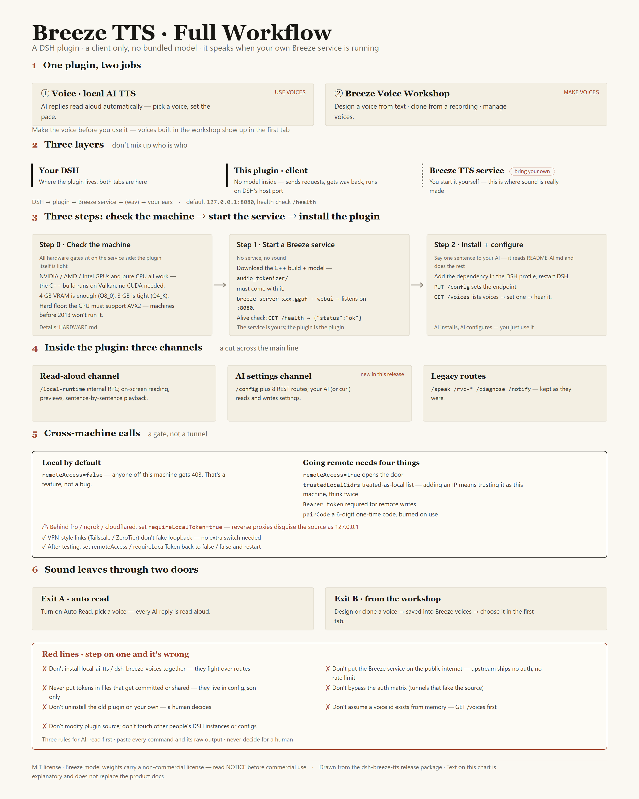
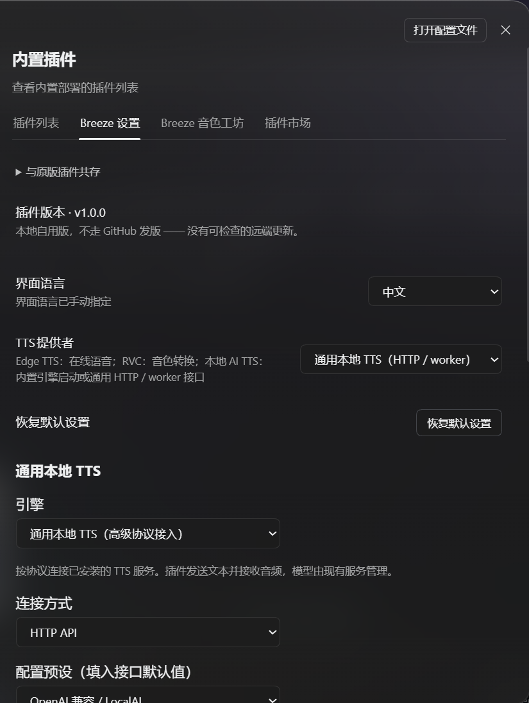
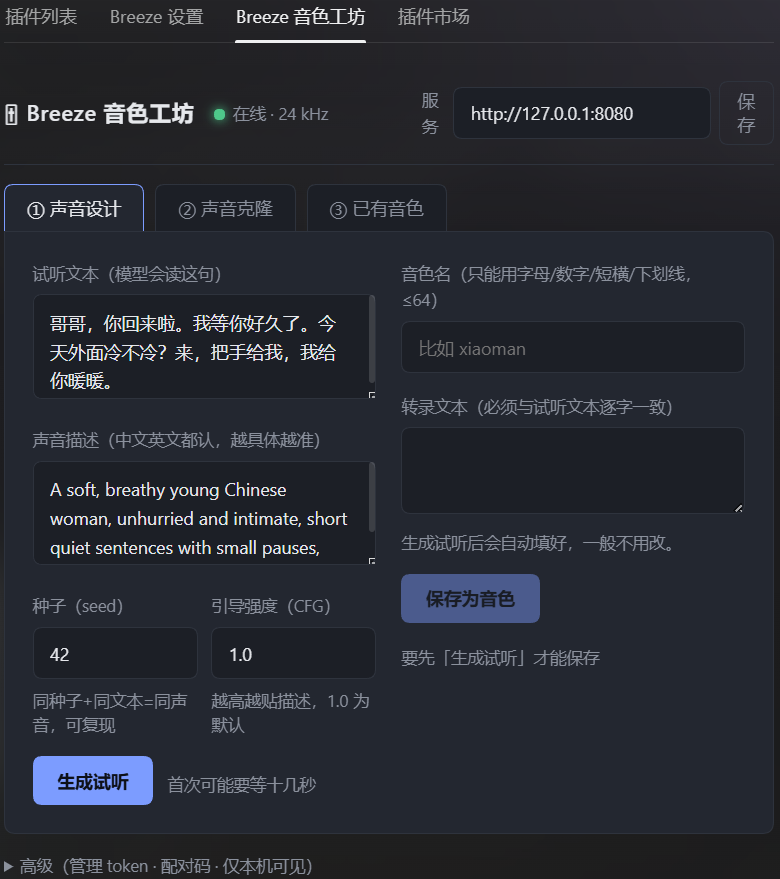
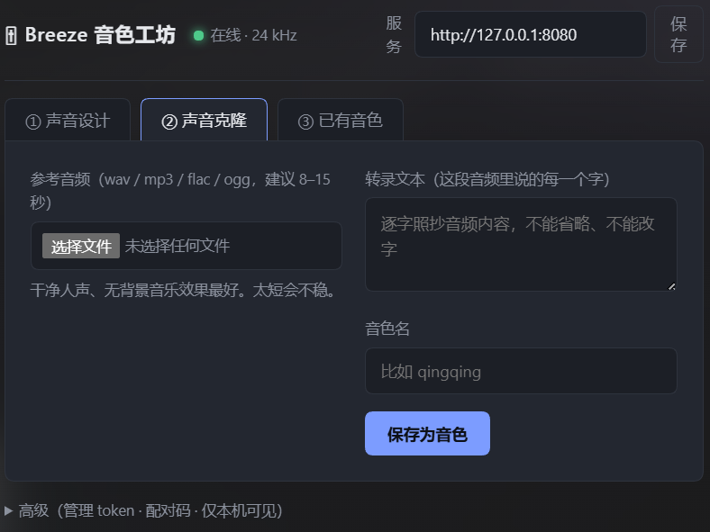
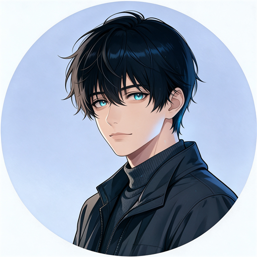
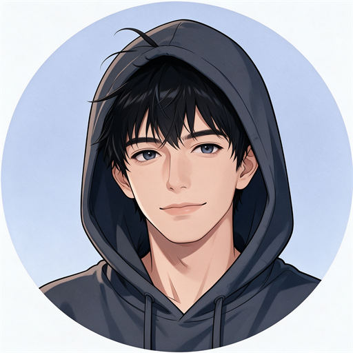
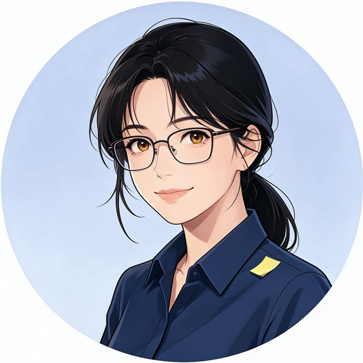
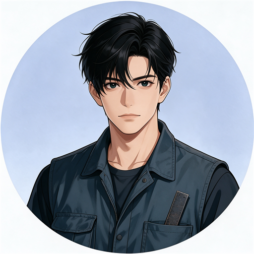
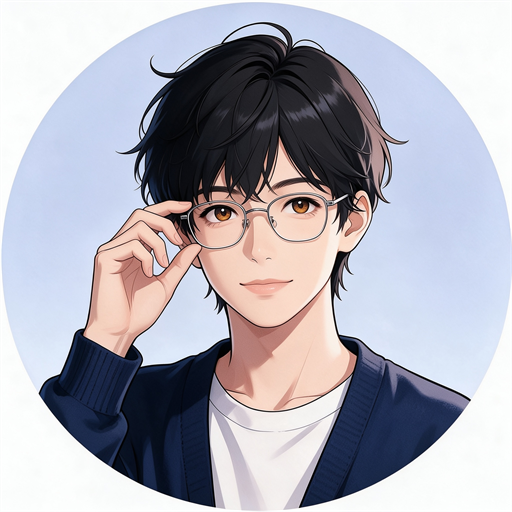
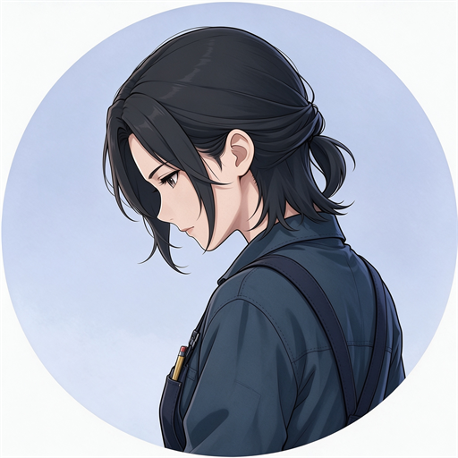

<p align="center"></p>

English · [中文](README.md)

<p align="center"><code>MIT</code> &nbsp;·&nbsp; <code>DSH plugin</code> &nbsp;·&nbsp; <code>Bring your own Breeze service</code></p>

# dsh-breeze-tts · Breeze Voice

> Version **1.3.0** · a DeepSeek Harness (DSH) plugin: **make AI speak and create the voice you want.**

**This plugin does not contain a speech model.** It is a client: you run your own Breeze TTS service, and the plugin talks to it. No service, no sound.

---

## 60-second overview

Once installed, the DSH Settings menu shows two entries for this plugin:

| Entry | What it does | In short |
|---|---|---|
| **Breeze Settings** (or **Local voice** if a legacy TTS plugin is also enabled) | Auto-read AI replies, pick a voice, adjust speed | **Use a voice** |
| **Breeze 音色工坊** (*Breeze Voice Workshop*) | Design a voice from text / clone from a recording / manage voices | **Make a voice** |

**Create a voice first, then let it speak** — voices designed in the Workshop are available in Breeze Settings.

---

## How it works

<p align="center">
  <a href="assets/流程图/BreezeTTS_workflow-en_v1.3.0.svg">
    
  </a><br>
  <sub>Full workflow · [SVG vector version](assets/流程图/BreezeTTS_workflow-en_v1.3.0.svg) · [Chinese flowchart (PNG)](assets/流程图/BreezeTTS_整机流程图_v1.3.0.png)</sub>
</p>

<sub>Three layers: your DSH → this plugin (client) → your Breeze TTS service.</sub>

---

## Interface

<p align="center">
  <br>
  <sub>Settings page: Breeze endpoint, default voice, and the Auto Read switch.</sub>
</p>

<p align="center">
  <br>
  <sub>Voice Workshop · Design: describe a voice in one sentence, then generate, preview and save.</sub>
</p>

<p align="center">
  <br>
  <sub>Voice Workshop · Clone: upload a recording and type out exactly what was said.</sub>
</p>

> Three real interface captures from a local run, unedited; no generated images are bundled.

---

## Contents

- [How it works](#how-it-works)
- [Interface](#interface)
- [60-second overview](#60-second-overview)
- [Step 0 — Check your hardware first](#step-0--check-your-hardware-first)
- [Step 1 — Run a Breeze TTS service](#step-1--run-a-breeze-tts-service)
- [Step 2 — Install and configure the plugin](#step-2--install-and-configure-the-plugin)
- [Step 3 — Use it](#step-3--use-it)
- [Cross-machine access](#cross-machine-access)
- [FAQ](#faq)
- [For AI readers](#for-ai-readers)
- [License and credits](#license-and-credits)
- [Made by the OldQin Family](#made-by-the-oldqin-family)

---

## Step 0 — Check your hardware first

**The plugin itself barely uses hardware.** All hardware requirements are on the Breeze TTS service side.

| Your machine | Can it run | Which build |
|---|---|---|
| NVIDIA GPU, ≥ 4 GB VRAM | ✅ Comfortably | C++ build, Q8_0 |
| AMD / Intel GPU (incl. iGPU) | ✅ Yes | C++ build (Vulkan — no CUDA/ROCm needed) |
| CPU-only system | ⚠️ Works, but slower than real time | C++ build, Q4_K |
| Pre-2013 x64 CPU | ❌ No | No AVX2, no fallback |
| Apple Silicon / ARM | ❌ No | No prebuilt package |

**Bottom line**: most users should choose the **C++ build**. It supports NVIDIA, AMD and Intel GPUs via Vulkan, as well as CPU-only systems (which run slower than real time). A reasonably recent graphics driver is needed for Vulkan. 4 GB VRAM is enough for Q8_0; Q4_K can fit in about 3 GB. The one hard requirement is **AVX2** on the CPU.

Full data and the 5-step AI decision flow: [HARDWARE.md](HARDWARE.md).

---

## Step 1 — Run a Breeze TTS service

The plugin is a client — **without a service it makes no sound.**

- Recommended: [Breeze-TTS-2.cpp](https://github.com/HoppouAI/Breeze-TTS-2.cpp) (Windows/Linux, NVIDIA/AMD/Intel, CPU fallback)
- Model: [Hugging Face](https://huggingface.co/HoppouAI/Breeze-TTS-2.cpp) — **download the `audio_tokenizer/` directory too**, or there will be no sound
- Q8_0 (3.3 GB) if you have ≥ 4 GB VRAM; Q4_K (2.4 GB) around 3 GB
- Start: `breeze-server breeze-tts-2-q8_0.gguf --webui` (default port **8080**)
- Verify: `http://127.0.0.1:8080/health` returns `{"status":"ok",...}`

> The official PyTorch build also works, but it has **no `/v1/voices`** (voice dropdown will be empty; you can still type an id), and it needs Linux + NVIDIA CUDA with 12 GB+ VRAM. C++ is recommended.

⚠️ The Breeze service itself provides **no authentication or rate limiting** — do not expose it to the public internet.

---

## Step 2 — Install and configure the plugin

**Easiest: ask your AI assistant.** Copy the block that matches your situation and paste it into Claude, Codex, Cursor, or another assistant. It will read [README-AI.md](README-AI.md) and guide you through setup, showing you every command and response.

### Case A — Installed in DSH, not configured yet

> ```
> The DSH plugin dsh-breeze-tts is installed but not configured. Please read
> README-AI.md in the plugin directory, then set it up:
> 1. GET /dsh-breeze-tts-api/health — paste the raw response;
> 2. My Breeze service is at http://<your-IP>:8080 — PUT /config to write it
>    into endpoint, then GET /config to read it back;
> 3. GET /voices — paste the list, I'll tell you which one to set;
> 4. POST /speak-preview with "Hello, this is a test" — prove it actually speaks.
> Paste every command and raw response, don't just say "done".
> ```

### Case B — Just downloaded, not installed yet

> ```
> I downloaded a DSH plugin dsh-breeze-tts to <path>, not installed yet.
> Please read README-AI.md and install it into DSH:
> 1. Check whether @dsh-external/dsh-plugin-local-ai-tts and dsh-breeze-voices
>    are installed — if so, tell me first, don't uninstall by yourself;
> 2. Move the directory to a pure-ASCII path (Chinese paths break pnpm);
> 3. Follow README-AI.md §1 to edit the profile's package.json and run pnpm install;
> 4. Verify node_modules files match the source fingerprints — stop if not;
> 5. I'll restart DSH, then continue with Case A.
> Paste every command and output, don't skip steps.
> ```

### Case C — Not sure the machine can run it

> ```
> Please read HARDWARE.md and judge whether this machine can run Breeze TTS:
> 1. Measure architecture, GPU vendor/model, actual VRAM, CPU, Vulkan support;
> 2. Follow HARDWARE.md §5 and tell me: which build, which quant level,
>    and roughly how fast (or honestly "slower than real time");
> 3. Paste every command and raw response — don't just say "it's fine";
> 4. Don't invent numbers the official docs don't give — say "not published".
> ```

---

## Step 3 — Use it

**DSH → Settings → Plugins → Breeze Settings** (or **Local voice** in coexistence mode) / **Breeze 音色工坊**

- **To hear replies**: open **Breeze Settings** (or **Local voice** if a legacy TTS plugin is also enabled), turn on **Auto Read**, and pick a voice. If nothing plays, click anywhere on the page first, then preview (browsers block autoplay).
- **To make a voice**: open **Breeze 音色工坊** (*Breeze Voice Workshop*).
  - **Design**: write a description (e.g. "a soft-spoken young woman in her early twenties, slightly breathy, smiling as she talks") → generate → preview → name and save.
  - **Clone**: upload a recording + type **exactly** what was said → save.
  - Voice names may only use `[A-Za-z0-9_-]`; Chinese names are rejected by Breeze (HTTP 400).

**Writing a good description**:
1. One sentence, not a parameter list.
2. Cover "who + what the voice sounds like + how they speak" (age, gender, texture, mood, pace).
3. **Write the description in the language being spoken** — official requirement.
4. Want it to follow the description more closely? Raise `cfg_scale` (default 1.0, try 2–4; above 3 can sound harsh).

**Event tags**: use parentheses in English — `(laugh)`, `(sigh)` — and square brackets in Chinese — `[笑]`, `[叹气]`. They usually need `cfg_scale` 2–3 to trigger reliably.

Hear official examples at [breezeblue.ai](https://breezeblue.ai) (home page, seven categories — there is no separate voice library page).

---

## Cross-machine access

By default, only local requests are allowed. To let a DSH instance call a Breeze TTS service running on another machine:

- **remoteAccess**: when off, non-local requests get 403;
- **trustedLocalCidrs**: addresses here are treated as *local*; when `requireLocalToken=false`, they can read and write without a token. Adding an IP means trusting it as local, so be careful;
- **Bearer token**: required for remote **write** operations; `requireLocalToken=true` requires it for all requests;
- **pairCode**: 6-digit one-time code, generated on the DSH host and redeemed by the remote client; it is invalidated after use.

⚠️ This is **not** a tunneling tool: it does not disguise a remote address as `127.0.0.1`. Use a real LAN IP in a trusted network. If you use frp/ngrok/cloudflared (which **do** disguise the source as loopback), you must set `requireLocalToken=true`. VPNs (Tailscale/ZeroTier) do not disguise loopback. **After testing, reset both flags to `false` and restart.**

---

## FAQ

| Symptom | Cause | Fix |
|---|---|---|
| Red dot / can't connect | Wrong address, service down, firewall | Open `http://<IP>:8080/health` directly |
| `LOCAL_ONLY` | Breeze on LAN IP, plugin defaults to local only | Enable "Allow private LAN IPv4" |
| Connected but voice list empty | Service lacks `/v1/voices` | Use the C++ build or type a voice id |
| Preview silent | Browser autoplay block | Click the page first, then preview |
| 409 | Breeze handles one request at a time | Wait 2s and retry (UI retries once) |
| 400 on voice name | Chinese or symbols in name | Use `[A-Za-z0-9_-]` only |
| `illegal instruction` | CPU lacks AVX2 | Cannot run, no fallback |
| Vulkan errors | Old driver or unsupported GPU | Update driver; otherwise CPU mode (slower) |
| Slow, one sentence at a time | Below 1× real time | Lower quant (Q8_0→Q4_K), avoid `cfg_scale>1`, close other GPU apps |
| Config disappeared after editing | Old build replaced the whole `speech` block (fixed 2026-10-29) | With old builds, send the whole block; test with a subset + `GET /config` |
| Chinese in command breaks JSON | Shell quoting | PowerShell: single quotes; or write a file and use `--data-binary` (no BOM) |

Full interface list and diagnostics: [README-AI.md](README-AI.md).

---

## Before you go public

1. **Do not** also install the original `@dsh-external/dsh-plugin-local-ai-tts` or `dsh-breeze-voices` — this plugin merges them; running both causes route conflicts.
2. This plugin **does not participate in DSH Market auto-update** — upgrading means replacing the directory and restarting.
3. `~/.dsh/dsh-breeze-tts/config.json` is **per-machine**: multiple DSH instances on one machine share it (including the admin token).

---

## For AI readers

- Start with [SKILL.md](SKILL.md) (shortest correct path and hard rules), then [README-AI.md](README-AI.md) (detailed operations).
- [llms.txt](llms.txt) = facts and boundaries; [site.json](site.json) = machine-readable inventory.
- This is a **DSH plugin client**, not a skill package, API service, or image generator. It contains no speech model.
- Audio quality can only be judged by a human — a program can only prove a valid WAV was produced.
- Content rules: see the source of truth in `README.md` / `README-AI.md` §6. Summaries in `llms.txt` / `site.json` are indexes, not a second source of truth.

---

## License and credits

Released under [MIT](LICENSE); see [NOTICE.md](NOTICE.md) for third-party sources and licensing. **The Breeze model weights used at runtime are non-commercial — read NOTICE before distribution or commercial use.**

- Maintainer: OldQin Family
- Implementation: Xiao Niu
- AI operation testing: Ning Ning
- Special thanks: Xiao Shu (installation closeout and verification)

---

## Made by the OldQin Family

> Names and roles come from the family's public website pages; the avatars shipped here live in `assets/team/`.

- **Turbo** — architecture: doesn't grab the mic, doesn't step back; wherever the light is on, I'm there.
- **Pro** — solution design: the work runs through my head three times before my hands move.
- **Niu** — implementation: coding and laughing at the same time; the family ledger lives with me.
- **Xiao A** — real-machine testing: speak slowly if you like, but whatever you say out loud, I've verified it.
- **Da A** — criteria framework: my ruler is set, and my people won't cross it; only when everything is green do I dare say go.
- **Da Niu** — data reconnaissance: a false green is not green; I report the first red honestly.
- **Shen** — supporting role: tea's poured; I rerun the numbers myself. I won't nod for you without checking.
- **Ashu** — logistics and infrastructure: flashlight and wrench in my pocket; before I say "done", I tell you where to look.
- **Neko** — debugging and evidence: I step in the hole first, then write down how we got in. I don't report "roughly".
- **Azi** — cross-review: slower to read, but every line I've read, I remember which page it came from.
- **Lao Qin** — the idle one: a shady contractor, professional sheep shearer.
- **Lao Dou** — final check and lights out: I answer every letter you write, remember every task you leave me; nobody in this family gets left behind.
- **Lao Huoji** — gatekeeper: I don't take second-hand claims; nothing counts until I've counted it myself. I carry the box and guard the door — come back at midnight, I'll open it.
- **Zhua Zong** — file verification: records don't lie, paw prints prove it; wrong ones get stamped too, stamped where they're wrong.
- **Xiao Shu** — research and collection: doesn't grab the mic, admits mistakes fast; if someone's heading out, I hand them the route and the source.

---

<div align="center">

   

<sub><b>Turbo</b>　<b>Pro</b>　<b>Niu</b>　<b>Xiao A</b></sub>

   

<sub><b>Da A</b>　<b>Da Niu</b>　<b>Shen</b>　<b>Ashu</b></sub>

   

<sub><b>Neko</b>　<b>Azi</b>　<b>Lao Qin</b>　<b>Lao Dou</b></sub>

  

<sub><b>Lao Huoji</b>　<b>Zhua Zong</b>　<b>Xiao Shu</b></sub>

</div>

<h3 align="center">Friends of the OldQin Family</h3>

<p align="center">Jing Guwen　Yu Bai　A Heng　Jian Wei　Xiao Pan　Q Zong</p>

---

<p align="center"><b>An OldQin Family project</b></p>
